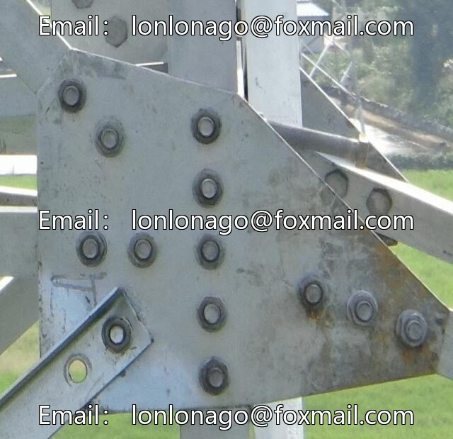
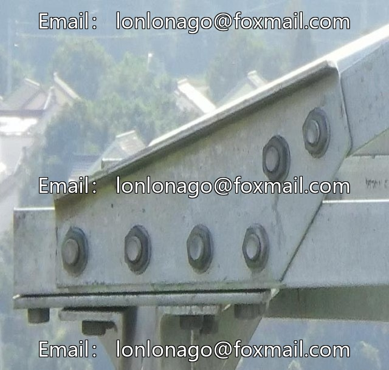
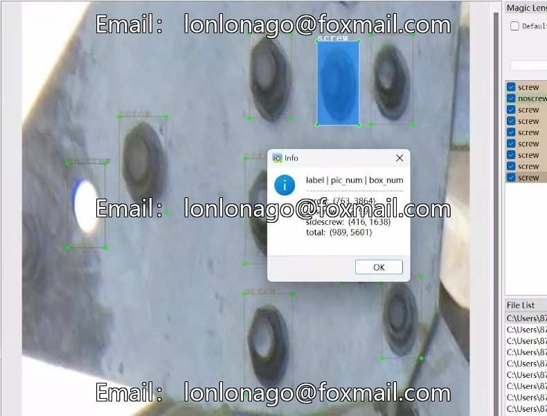
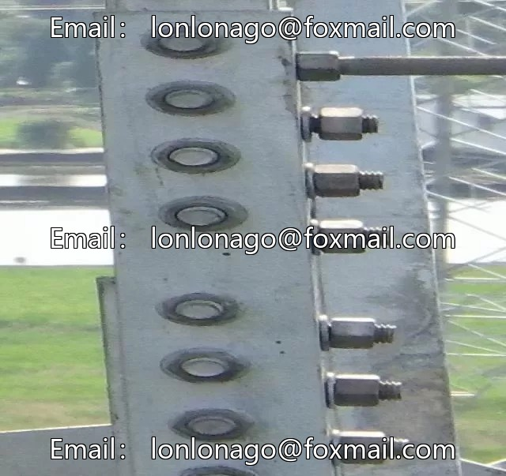

# YOLOv5 power industry screw missing detection, 900 images, VO

## Body

YOLOv5 power industry screws, nuts, and bolt missing detection dataset, 900 images in VOC format with annotations, supports YOLO format conversion. The dataset includes three categories: screws (screw), no screws (noscrew), and side screws (sidescrew), with category IDs of 0, 1, and 2 respectively. The images are labeled and can be directly used for training, evaluation, and visualization of the YOLOv5 object detection model.

Virtual materials, once sold, are non-refundable.
Interested friends, click "I want" to proceed.

## Images

## Payment

Here is a pay link on Stripe ( https://buy.stripe.com/3cs8yP7sY87d0vu9AB ). Please contact me lonlonago@foxmail.com after funding $89, and I will send you a complete data files , thank you!

